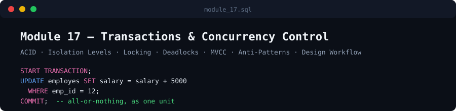

# Module 17 — Transactions & Concurrency Control

  

Part of the [SQL Engineering Handbook](../README.md).

## Prerequisites

- MySQL 8.4 (or 8.x) with InnoDB tables, and the shared `00_Schema`
- Rows the demos rely on: `employes.emp_id = 12`, and `departments.dept_id`
  values `4` and `7` (Lessons 01 and 04 verify this with a query before changing anything; the other files assume it)
- For the Lesson 01 consistency demo: a foreign key from
  `employes.manager_id` to `employes.emp_id` (check with
  `SHOW CREATE TABLE employes`)
- Two client connections for the two-session demos (second-session steps
  are commented out in each `.sql` file as copy-paste reference)
- Lesson 04 changes a global setting temporarily and needs a privileged
  account; it restores the original value afterwards
- Lesson 03's gap-lock demo creates and drops a temporary index; see
  [Module 15 — Indexes](../15_INDEXES/README.md) for index background

## Learning Objectives

By the end of this module you will be able to:

- Explain each ACID guarantee precisely, and what it does NOT cover
- Choose an isolation level deliberately, with a named reason
- Use locking reads (`FOR UPDATE` / `FOR SHARE`) to close read-then-
  write races, and understand gap/next-key locks
- Diagnose and prevent deadlocks via consistent lock ordering
- Explain how MVCC gives readers a consistent snapshot without
  blocking writers
- Recognize seven concrete transaction anti-patterns in real code
- Apply a seven-step workflow to design a new transaction boundary

## Folder Structure

```
17_TRANSACTIONS_AND_CONCURRENCY/
├── README.md
├── 01_ACID_AND_TRANSACTION_FUNDAMENTALS.md / .sql
├── 02_ISOLATION_LEVELS_AND_READ_PHENOMENA.md / .sql
├── 03_LOCKING_MECHANISMS.md / .sql
├── 04_DEADLOCKS.md / .sql
├── 05_MVCC.md / .sql
├── 06_TRANSACTION_ANTI_PATTERNS.md / .sql
├── 07_TRANSACTION_DESIGN_WORKFLOW.md / .sql
├── PRACTICE_PROBLEMS.md
├── SOLUTIONS.sql
├── CONTRIBUTING.md
└── assets/
    ├── images/hero.svg
    └── diagrams/
        ├── acid-overview.svg
        ├── isolation-levels-matrix.svg
        ├── lock-compatibility.svg
        ├── deadlock-cycle.svg
        └── mvcc-versions.svg
```

## Learning Flow

| # | Lesson | Builds On | Key Takeaway |
|---|---|---|---|
| 01 | [ACID & Transaction Fundamentals](./01_ACID_AND_TRANSACTION_FUNDAMENTALS.md) | — | Four separate guarantees; autocommit means every unwrapped statement is already its own transaction |
| 02 | [Isolation Levels & Read Phenomena](./02_ISOLATION_LEVELS_AND_READ_PHENOMENA.md) | 01 | Isolation is a spectrum (dirty / non-repeatable / phantom reads); MySQL defaults to REPEATABLE READ |
| 03 | [Locking Mechanisms](./03_LOCKING_MECHANISMS.md) | 02 | Isolation level alone doesn't close a read-then-write race — locking (or an atomic statement) does |
| 04 | [Deadlocks](./04_DEADLOCKS.md) | 03 | A cyclic wait; MySQL auto-detects and kills one transaction; consistent lock ordering is the real fix |
| 05 | [MVCC](./05_MVCC.md) | 02–03 | The actual mechanism (undo log, row versions) behind REPEATABLE READ's non-blocking reads |
| 06 | [Transaction Anti-Patterns](./06_TRANSACTION_ANTI_PATTERNS.md) | 01–05 | Seven named failure modes, each a violation of an earlier lesson's principle |
| 07 | [Transaction Design Workflow](./07_TRANSACTION_DESIGN_WORKFLOW.md) | 01–06 | A repeatable 7-step process for designing a new transaction boundary |

## Industry Use Cases

- **Payments/ledgers**: atomicity across a debit and its matching credit
- **Inventory**: closing the classic oversell race with `FOR UPDATE` or an atomic guarded `UPDATE`
- **Booking systems**: gap/next-key locking to prevent double-booking a slot
- **Batch jobs**: oversized-transaction and lock-ordering anti-patterns at scale
- **Reporting**: choosing a weaker isolation level deliberately for staleness-tolerant reads

## Diagram Gallery

| Diagram | Covers |
|---|---|
| `acid-overview.svg` | The four ACID guarantees side by side |
| `isolation-levels-matrix.svg` | Isolation level × read phenomenon matrix |
| `lock-compatibility.svg` | Shared vs. exclusive lock compatibility |
| `deadlock-cycle.svg` | The cyclic-wait structure of a deadlock |
| `mvcc-versions.svg` | How MVCC reconstructs an older row version from the undo log |

## Interview Readiness

Each lesson ends with 2–3 interview questions targeting the specific
mechanism it covers. For broader interview preparation connecting
these concepts to business scenarios, see
[Module 18 — SQL Interview Questions](../18_SQL_INTERVIEW_QUESTIONS/README.md).

## Verification Status

All eight `.sql` files were executed top-to-bottom in a single connection
against MySQL 8.0 (InnoDB) using a stand-in `00_Schema` (3 tables, 10
departments, 50 employees, self-referencing FK on `manager_id`). Each file
ran without unexpected errors (the one expected error is the deliberate FK
violation in Lesson 01) and left the data, schema objects, global settings
and open transactions exactly as it found them. The two-session claims
(non-repeatable and phantom reads, dirty reads, MVCC snapshots, `FOR UPDATE`
blocking, gap-lock blocking under `REPEATABLE READ` and not under
`READ COMMITTED`, deadlock and consistent lock ordering, lock-wait timeout vs.
deadlock rollback scope, statement-error behavior) were reproduced with real
concurrent connections.

Not yet verified: MySQL 8.4 specifically, the handbook's real `00_Schema`
seed data, and links to sibling modules (they live outside this folder).

## Completion Checklist

- [x] All 7 lessons complete (.md + .sql)
- [x] 5 diagrams, all valid SVG
- [x] `PRACTICE_PROBLEMS.md` + `SOLUTIONS.sql`
- [x] `CONTRIBUTING.md`
- [x] Hero banner
- [x] Cross-links to Module 18

---

**Previous Module:** [16 — Query Optimization](../16_QUERY_OPTIMIZATION/README.md) · **Next Module:** [18 — SQL Interview Questions](../18_SQL_INTERVIEW_QUESTIONS/README.md)
