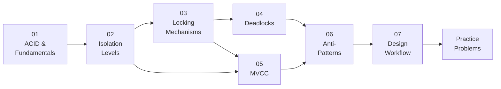
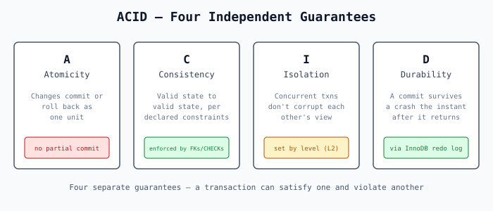
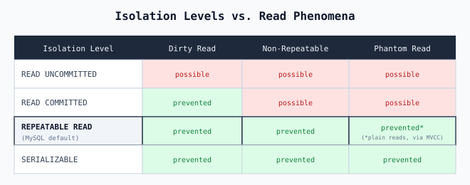
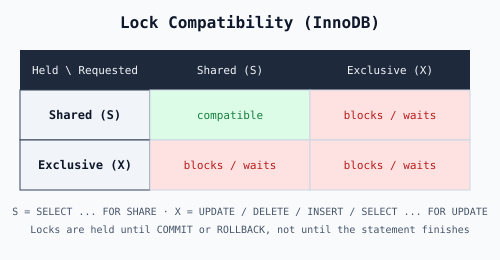
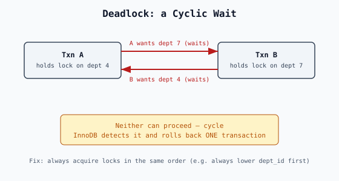
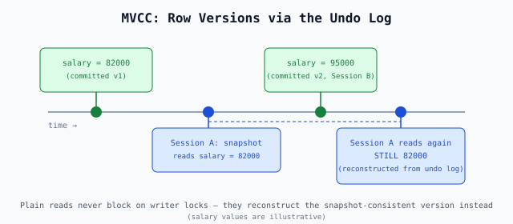

<div align="center">


# Module 17 · Transactions & Concurrency Control

**ACID, isolation levels, locking, deadlocks, MVCC and transaction design — taught with runnable MySQL 8.x demos.**

[](#-learning-path)
[](#-prerequisites)
[](#-prerequisites)
[](#-diagram-gallery)
[](#-verification-status)

[Start Lesson 01](./01_ACID_AND_TRANSACTION_FUNDAMENTALS.md) ·
[Learning Path](#-learning-path) ·
[Practice Problems](./PRACTICE_PROBLEMS.md) ·
[Solutions](./SOLUTIONS.sql) ·
[Handbook Home](../README.md)

</div>

---

## 📑 Table of Contents

- [Why This Module](#-why-this-module)
- [What You Will Learn](#-what-you-will-learn)
- [Learning Path](#-learning-path)
- [Prerequisites](#-prerequisites)
- [Quick Start](#-quick-start)
- [Repository Layout](#-repository-layout)
- [Diagram Gallery](#-diagram-gallery)
- [Quick Reference](#-quick-reference)
- [Industry Use Cases](#-industry-use-cases)
- [Practice & Interview Readiness](#-practice--interview-readiness)
- [Verification Status](#-verification-status)
- [Completion Checklist](#-completion-checklist)
- [Contributing](#-contributing)
- [Navigation](#-navigation)

---

## 🎯 Why This Module

Most concurrency bugs never show up in a single-session test. They appear under load: an oversold item, a double-booked slot, a debit without its credit, a deadlock at 2 a.m. This module teaches you to **reason about what the database actually guarantees**, where those guarantees stop, and how to design transaction boundaries that hold up when many sessions collide.

Every lesson pairs an explanation (`.md`) with an executable script (`.sql`), and the two-session behaviours were reproduced with real concurrent connections (see [Verification Status](#-verification-status)).

---

## 🧠 What You Will Learn

By the end of this module you will be able to:

- ✅ Explain each **ACID** guarantee precisely, and what it does **not** cover
- ✅ Choose an **isolation level** deliberately, with a named reason
- ✅ Use **locking reads** (`FOR UPDATE` / `FOR SHARE`) to close read-then-write races, and understand **gap / next-key locks**
- ✅ Diagnose and prevent **deadlocks** via consistent lock ordering
- ✅ Explain how **MVCC** gives readers a consistent snapshot without blocking writers
- ✅ Recognize **seven concrete transaction anti-patterns** in real code
- ✅ Apply a **seven-step workflow** to design a new transaction boundary

---

## 🗺️ Learning Path



| # | Lesson | Builds On | Key Takeaway | Read | Run |
|:-:|---|:-:|---|:-:|:-:|
| 01 | **ACID & Transaction Fundamentals** | — | Four separate guarantees; with autocommit, every unwrapped statement is already its own transaction | [📖 .md](./01_ACID_AND_TRANSACTION_FUNDAMENTALS.md) | [▶ .sql](./01_ACID_AND_TRANSACTION_FUNDAMENTALS.sql) |
| 02 | **Isolation Levels & Read Phenomena** | 01 | Isolation is a spectrum (dirty / non-repeatable / phantom reads); MySQL defaults to `REPEATABLE READ` | [📖 .md](./02_ISOLATION_LEVELS_AND_READ_PHENOMENA.md) | [▶ .sql](./02_ISOLATION_LEVELS_AND_READ_PHENOMENA.sql) |
| 03 | **Locking Mechanisms** | 02 | Isolation level alone doesn't close a read-then-write race — locking (or an atomic statement) does | [📖 .md](./03_LOCKING_MECHANISMS.md) | [▶ .sql](./03_LOCKING_MECHANISMS.sql) |
| 04 | **Deadlocks** | 03 | A cyclic wait; MySQL auto-detects it and kills one transaction; consistent lock ordering is the real fix | [📖 .md](./04_DEADLOCKS.md) | [▶ .sql](./04_DEADLOCKS.sql) |
| 05 | **MVCC** | 02–03 | The mechanism (undo log, row versions) behind `REPEATABLE READ`'s non-blocking reads | [📖 .md](./05_MVCC.md) | [▶ .sql](./05_MVCC.sql) |
| 06 | **Transaction Anti-Patterns** | 01–05 | Seven named failure modes, each a violation of an earlier lesson's principle | [📖 .md](./06_TRANSACTION_ANTI_PATTERNS.md) | [▶ .sql](./06_TRANSACTION_ANTI_PATTERNS.sql) |
| 07 | **Transaction Design Workflow** | 01–06 | A repeatable 7-step process for designing a new transaction boundary | [📖 .md](./07_TRANSACTION_DESIGN_WORKFLOW.md) | [▶ .sql](./07_TRANSACTION_DESIGN_WORKFLOW.sql) |
| ★ | **Practice Problems** | 01–07 | Apply everything to realistic scenarios | [📖 .md](./PRACTICE_PROBLEMS.md) | [▶ Solutions](./SOLUTIONS.sql) |

> **Suggested order:** go sequentially. Lessons 03 → 04 → 05 build directly on one another, and Lesson 06 only makes sense once 01–05 are solid.

---

## ✅ Prerequisites

<details open>
<summary><b>Environment</b></summary>

- **MySQL 8.4** (or any 8.x) with **InnoDB** tables
- The shared `00_Schema` from the handbook
- **Two client connections** for the two-session demos. Second-session steps are commented out in each `.sql` file as copy-paste reference.

</details>

<details open>
<summary><b>Data the demos rely on</b></summary>

- `employes.emp_id = 12` exists
- `departments.dept_id` values `4` and `7` exist

Lessons 01 and 04 verify this with a query before changing anything; the other files assume it.

</details>

<details>
<summary><b>Lesson-specific requirements</b></summary>

| Lesson | Requirement |
|---|---|
| [01 — ACID](./01_ACID_AND_TRANSACTION_FUNDAMENTALS.md) | A foreign key from `employes.manager_id` → `employes.emp_id` (check with `SHOW CREATE TABLE employes`) for the consistency demo |
| [03 — Locking](./03_LOCKING_MECHANISMS.md) | The gap-lock demo creates and drops a temporary index. See [Module 15 — Indexes](../15_INDEXES/README.md) for background. |
| [04 — Deadlocks](./04_DEADLOCKS.md) | Temporarily changes a **global setting**, so it needs a privileged account. It restores the original value afterwards. |

</details>

---

## ⚡ Quick Start

```bash
# 1. Open the first script in your MySQL client of choice, or run it directly:
mysql -u <user> -p <database> < 01_ACID_AND_TRANSACTION_FUNDAMENTALS.sql

# 2. For two-session demos, open a SECOND connection and paste the
#    commented "Session B" steps from the .sql file at the indicated moment.
```

**Recommended workflow per lesson**

1. 📖 Read the lesson `.md`
2. ▶ Run the matching `.sql` top-to-bottom in **Session A**
3. 🔀 Where the script says so, switch to **Session B** and paste the commented steps
4. 🧠 Answer the interview questions at the end of the lesson
5. ➡️ Move on to the next lesson

---

## 🗂️ Repository Layout

```text
17_TRANSACTIONS_AND_CONCURRENCY/
├── README.md
├── 01_ACID_AND_TRANSACTION_FUNDAMENTALS.md / .sql
├── 02_ISOLATION_LEVELS_AND_READ_PHENOMENA.md / .sql
├── 03_LOCKING_MECHANISMS.md / .sql
├── 04_DEADLOCKS.md / .sql
├── 05_MVCC.md / .sql
├── 06_TRANSACTION_ANTI_PATTERNS.md / .sql
├── 07_TRANSACTION_DESIGN_WORKFLOW.md / .sql
├── PRACTICE_PROBLEMS.md
├── SOLUTIONS.sql
├── CONTRIBUTING.md
└── assets/
    ├── images/hero.svg
    └── diagrams/
        ├── acid-overview.svg
        ├── isolation-levels-matrix.svg
        ├── lock-compatibility.svg
        ├── deadlock-cycle.svg
        └── mvcc-versions.svg
```

| File | Purpose |
|---|---|
| [`PRACTICE_PROBLEMS.md`](./PRACTICE_PROBLEMS.md) | Exercises covering the whole module |
| [`SOLUTIONS.sql`](./SOLUTIONS.sql) | Worked answers for the practice problems |
| [`CONTRIBUTING.md`](./CONTRIBUTING.md) | Conventions for improving or extending this module |
| [`assets/`](./assets) | Hero banner and the five concept diagrams |

---

## 🖼️ Diagram Gallery

<table>
<tr>
<td width="50%" align="center">
<b>The four ACID guarantees</b><br/>
<br/>
<sub>Lesson <a href="./01_ACID_AND_TRANSACTION_FUNDAMENTALS.md">01</a></sub>
</td>
<td width="50%" align="center">
<b>Isolation level × read phenomenon</b><br/>
<br/>
<sub>Lesson <a href="./02_ISOLATION_LEVELS_AND_READ_PHENOMENA.md">02</a></sub>
</td>
</tr>
<tr>
<td width="50%" align="center">
<b>Shared vs. exclusive lock compatibility</b><br/>
<br/>
<sub>Lesson <a href="./03_LOCKING_MECHANISMS.md">03</a></sub>
</td>
<td width="50%" align="center">
<b>Cyclic wait of a deadlock</b><br/>
<br/>
<sub>Lesson <a href="./04_DEADLOCKS.md">04</a></sub>
</td>
</tr>
<tr>
<td colspan="2" align="center">
<b>How MVCC rebuilds an older row version from the undo log</b><br/>
<br/>
<sub>Lesson <a href="./05_MVCC.md">05</a></sub>
</td>
</tr>
</table>

| Diagram | Source file |
|---|---|
| ACID overview | [`acid-overview.svg`](./assets/diagrams/acid-overview.svg) |
| Isolation levels matrix | [`isolation-levels-matrix.svg`](./assets/diagrams/isolation-levels-matrix.svg) |
| Lock compatibility | [`lock-compatibility.svg`](./assets/diagrams/lock-compatibility.svg) |
| Deadlock cycle | [`deadlock-cycle.svg`](./assets/diagrams/deadlock-cycle.svg) |
| MVCC versions | [`mvcc-versions.svg`](./assets/diagrams/mvcc-versions.svg) |

---

## 🧾 Quick Reference

A compact cheat sheet. Each row is explained properly in the linked lesson.

| Question | Short answer | Lesson |
|---|---|---|
| What does autocommit do? | Every statement outside an explicit transaction is its own transaction | [01](./01_ACID_AND_TRANSACTION_FUNDAMENTALS.md) |
| MySQL's default isolation level? | `REPEATABLE READ` | [02](./02_ISOLATION_LEVELS_AND_READ_PHENOMENA.md) |
| Does a higher isolation level fix read-then-write races? | Not by itself. Use a locking read or an atomic guarded statement. | [03](./03_LOCKING_MECHANISMS.md) |
| How do I stop two sessions from overselling or double-booking? | `FOR UPDATE`, or an atomic guarded `UPDATE`; gap/next-key locks for slots | [03](./03_LOCKING_MECHANISMS.md) |
| What happens on a deadlock? | MySQL detects the cycle and rolls back one transaction | [04](./04_DEADLOCKS.md) |
| What is the real fix for deadlocks? | Acquire locks in a consistent order | [04](./04_DEADLOCKS.md) |
| How can readers not block writers? | MVCC: row versions rebuilt from the undo log | [05](./05_MVCC.md) |
| What goes wrong in real code? | Seven named anti-patterns | [06](./06_TRANSACTION_ANTI_PATTERNS.md) |
| How do I design a new transaction? | Follow the seven-step workflow | [07](./07_TRANSACTION_DESIGN_WORKFLOW.md) |

---

## 🏭 Industry Use Cases

| Domain | Concurrency problem | Technique | Lesson |
|---|---|---|---|
| 💳 **Payments / ledgers** | A debit must never exist without its matching credit | Atomicity across both writes | [01](./01_ACID_AND_TRANSACTION_FUNDAMENTALS.md) |
| 📦 **Inventory** | The classic oversell race | `FOR UPDATE` or an atomic guarded `UPDATE` | [03](./03_LOCKING_MECHANISMS.md) |
| 📅 **Booking systems** | Double-booking the same slot | Gap / next-key locking | [03](./03_LOCKING_MECHANISMS.md) |
| ⚙️ **Batch jobs** | Oversized transactions, inconsistent lock order | Right-sized transactions, ordered locking | [04](./04_DEADLOCKS.md) · [06](./06_TRANSACTION_ANTI_PATTERNS.md) |
| 📊 **Reporting** | Long reads that don't need the freshest data | Deliberately weaker isolation level | [02](./02_ISOLATION_LEVELS_AND_READ_PHENOMENA.md) · [05](./05_MVCC.md) |

---

## 🎤 Practice & Interview Readiness

- Each lesson ends with **2–3 interview questions** targeting the mechanism it covers.
- [`PRACTICE_PROBLEMS.md`](./PRACTICE_PROBLEMS.md) ties the concepts together, and [`SOLUTIONS.sql`](./SOLUTIONS.sql) holds the answers. Try each problem before opening the solution.
- For broader interview preparation that connects these concepts to business scenarios, continue to [Module 18 — SQL Interview Questions](../18_SQL_INTERVIEW_QUESTIONS/README.md).

---

## 🔬 Verification Status

All **eight `.sql` files** were executed top-to-bottom in a single connection against **MySQL 8.0 (InnoDB)** using a stand-in `00_Schema` (3 tables, 10 departments, 50 employees, self-referencing FK on `manager_id`). Each file ran without unexpected errors (the one expected error is the deliberate FK violation in Lesson 01) and left the data, schema objects, global settings and open transactions exactly as it found them.

The following two-session claims were reproduced with **real concurrent connections**:

| Area | Reproduced behaviour |
|---|---|
| Read phenomena | Non-repeatable reads, phantom reads, dirty reads |
| MVCC | Consistent snapshots |
| Locking | `FOR UPDATE` blocking; gap-lock blocking under `REPEATABLE READ` and not under `READ COMMITTED` |
| Deadlocks | Deadlock detection and consistent lock ordering; lock-wait timeout vs. deadlock rollback scope |
| Errors | Statement-error behaviour |

> [!NOTE]
> **Not yet verified:** MySQL 8.4 specifically, the handbook's real `00_Schema` seed data, and links to sibling modules (they live outside this folder).

---

## 📋 Completion Checklist

- [x] All 7 lessons complete (`.md` + `.sql`)
- [x] 5 diagrams, all valid SVG
- [x] [`PRACTICE_PROBLEMS.md`](./PRACTICE_PROBLEMS.md) + [`SOLUTIONS.sql`](./SOLUTIONS.sql)
- [x] [`CONTRIBUTING.md`](./CONTRIBUTING.md)
- [x] Hero banner
- [x] Cross-links to Module 18

---

## 🤝 Contributing

Found a mistake, or want to improve a demo? Read [`CONTRIBUTING.md`](./CONTRIBUTING.md) first. Please keep every `.sql` file runnable top-to-bottom and leave the database exactly as you found it.

---

## 🧭 Navigation

<div align="center">

[⬅️ **Previous:** 16 — Query Optimization](../16_QUERY_OPTIMIZATION/README.md) &nbsp;|&nbsp; [🏠 **SQL Engineering Handbook**](../README.md) &nbsp;|&nbsp; [**Next:** 18 — SQL Interview Questions ➡️](../18_SQL_INTERVIEW_QUESTIONS/README.md)

<sub>Part of the <a href="../README.md">SQL Engineering Handbook</a> · Module 17 of the series</sub>

</div>
