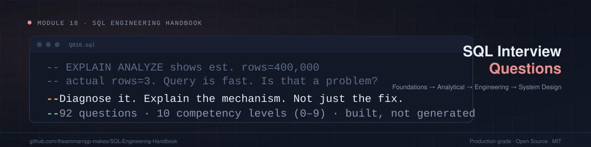
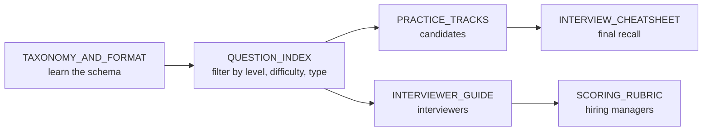
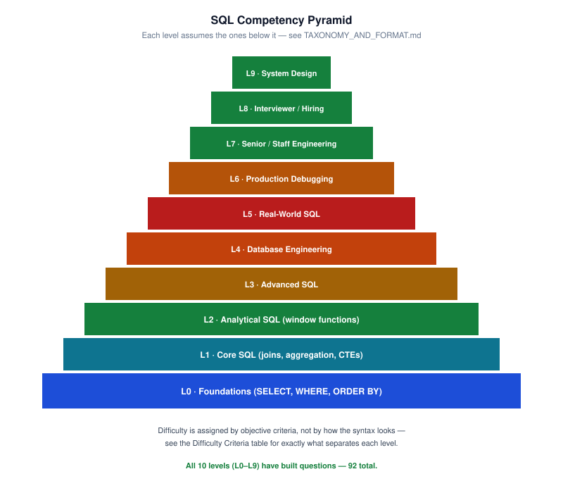
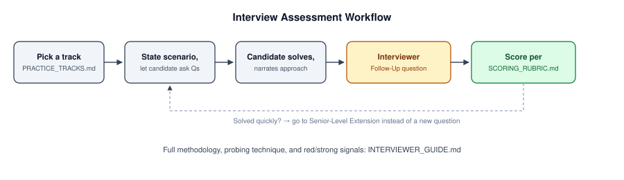

<div align="center">



# Module 18 · SQL Interview Questions

**A structured SQL assessment system: 92 questions across 10 competency levels, built for candidates, interviewers and hiring managers.**

[](#-current-coverage)
[-orange?style=for-the-badge)](#-competency-levels)
[](#-current-coverage)
[](#-contributing)

[Taxonomy](./TAXONOMY_AND_FORMAT.md) ·
[Question Index](./QUESTION_INDEX.md) ·
[Practice Tracks](./PRACTICE_TRACKS.md) ·
[Interviewer Guide](./INTERVIEWER_GUIDE.md) ·
[Scoring Rubric](./SCORING_RUBRIC.md) ·
[Handbook Home](../README.md)

</div>

---

## 📑 Table of Contents

- [What This Module Is](#-what-this-module-is)
- [Who Should Use This](#-who-should-use-this)
- [Competency Levels](#-competency-levels)
- [Current Coverage](#-current-coverage)
- [How the Question Bank Is Organized](#-how-the-question-bank-is-organized)
- [Navigation](#-navigation)
- [Diagram Gallery](#-diagram-gallery)
- [Dataset Approach](#-dataset-approach)
- [Related Modules](#-related-modules)
- [Repository Layout](#-repository-layout)
- [Validation](#-validation)
- [Contributing](#-contributing)
- [Module Navigation](#-module-navigation)

---

## 🎯 What This Module Is

A structured SQL assessment system, **not a list of trivia**. It serves two audiences at once: people **preparing** for SQL interviews and people **running** them. Every question tests whether someone can *apply* SQL engineering judgment, not whether they've memorized syntax.

> [!IMPORTANT]
> This module does **not** re-teach SQL. It assumes, and cross-links to, the handbook's core curriculum
> ([`01_Fundamentals`](../01_Fundamentals) through [`17_TRANSACTIONS_AND_CONCURRENCY`](../17_TRANSACTIONS_AND_CONCURRENCY)).
> If a question's underlying concept is unfamiliar, follow its **Related Modules** link and learn it there first.

---

## 👥 Who Should Use This

| You are a… | Start here | What you get |
|---|---|---|
| 🧑‍💻 **Candidate** | [`PRACTICE_TRACKS.md`](./PRACTICE_TRACKS.md) | Pre-built question sequences by role and length |
| 🎤 **Interviewer** | [`INTERVIEWER_GUIDE.md`](./INTERVIEWER_GUIDE.md) | Interview methodology, not just a question list |
| 🧭 **Hiring manager** | [`SCORING_RUBRIC.md`](./SCORING_RUBRIC.md) | An eight-dimension competency scoring model |
| 🛠️ **Engineer self-assessing** | [`FAQ.md`](./FAQ.md) | Guidance on honest self-scoring |



---

## 🪜 Competency Levels

Ten levels, numbered **0–9**. Each level assumes the ones below it. Every level folder contains a `QUESTION_BANK.md`.

| Level | Name | Question bank |
|:-:|---|---|
| **0** | Foundations | [`01_FOUNDATIONS`](./01_FOUNDATIONS/QUESTION_BANK.md) |
| **1** | Core SQL | [`02_CORE_SQL`](./02_CORE_SQL/QUESTION_BANK.md) |
| **2** | Analytical SQL | [`03_ANALYTICAL_SQL`](./03_ANALYTICAL_SQL/QUESTION_BANK.md) |
| **3** | Advanced SQL | [`04_ADVANCED_SQL`](./04_ADVANCED_SQL/QUESTION_BANK.md) |
| **4** | Database Engineering | [`05_DATABASE_ENGINEERING`](./05_DATABASE_ENGINEERING/QUESTION_BANK.md) |
| **5** | Real-World SQL | [`06_REAL_WORLD_SQL`](./06_REAL_WORLD_SQL/QUESTION_BANK.md) |
| **6** | Production Debugging | [`07_PRODUCTION_DEBUGGING`](./07_PRODUCTION_DEBUGGING/QUESTION_BANK.md) |
| **7** | Senior / Staff Engineering | [`08_SENIOR_ENGINEERING`](./08_SENIOR_ENGINEERING/QUESTION_BANK.md) |
| **8** | Interviewer / Hiring | [`09_INTERVIEWER_QUESTIONS`](./09_INTERVIEWER_QUESTIONS/QUESTION_BANK.md) |
| **9** | SQL System Design | [`10_SQL_SYSTEM_DESIGN`](./10_SQL_SYSTEM_DESIGN/QUESTION_BANK.md) |

<div align="center">

<br/><sub>All 10 levels (L0–L9), all built</sub>
</div>

---

## 📊 Current Coverage

**92 questions, built across all 10 competency levels.** This is the third expansion pass beyond the original 48-question breadth pilot, targeted at Levels 1–2 (the largest remaining gap to the ~490 target). No new levels were added.

| Level | Name | Built | Target | Progress |
|:-:|---|:-:|:-:|---|
| 0 | Foundations | **10** | ~40 | `▰▰▰▰▰▱▱▱▱▱▱▱▱▱▱▱▱▱▱▱` 25% |
| 1 | Core SQL | **16** | ~60 | `▰▰▰▰▰▱▱▱▱▱▱▱▱▱▱▱▱▱▱▱` 27% |
| 2 | Analytical SQL | **17** | ~80 | `▰▰▰▰▱▱▱▱▱▱▱▱▱▱▱▱▱▱▱▱` 21% |
| 3 | Advanced SQL | **9** | ~70 | `▰▰▰▱▱▱▱▱▱▱▱▱▱▱▱▱▱▱▱▱` 13% |
| 4 | Database Engineering | **8** | ~70 | `▰▰▱▱▱▱▱▱▱▱▱▱▱▱▱▱▱▱▱▱` 11% |
| 5 | Real-World SQL | **8** | ~70 | `▰▰▱▱▱▱▱▱▱▱▱▱▱▱▱▱▱▱▱▱` 11% |
| 6 | Production Debugging | **6** | ~40 | `▰▰▰▱▱▱▱▱▱▱▱▱▱▱▱▱▱▱▱▱` 15% |
| 7 | Senior / Staff Engineering | **6** | ~40 | `▰▰▰▱▱▱▱▱▱▱▱▱▱▱▱▱▱▱▱▱` 15% |
| 8 | Interviewer / Hiring | **6** | ~30 | `▰▰▰▰▱▱▱▱▱▱▱▱▱▱▱▱▱▱▱▱` 20% |
| 9 | SQL System Design | **6** | ~30 | `▰▰▰▰▱▱▱▱▱▱▱▱▱▱▱▱▱▱▱▱` 20% |
| | **Total** | **92** | **~490** | `▰▰▰▰▱▱▱▱▱▱▱▱▱▱▱▱▱▱▱▱` 19% |

### What each question contains

Optional fields are omitted where they would add little value, not padded in for uniformity.

| Element | Coverage |
|---|---|
| `### Explanation` or `### Expected Answer` | **66 of 92** questions |
| `### Interviewer Follow-Up` | **86 of 92** questions |
| Explicit `### Common Mistake` (or Level 8's `Weak Answer`) | **About 10 of 92** carry the literal heading |
| Named "senior-level extension" | A handful. Levels 7–9 serve as the extension by design. |
| Explicit `Related Modules` link | **26 of 92** questions |

<details>
<summary><b>Format notes and known gaps (read before auditing)</b></summary>

- Scenario-style and interviewer-facing questions (for example Levels 6 and 8) use their own section structure instead of the exact headings above.
- **Q041–Q044, Q077 and Q078** have no separate follow-up section.
- On most questions the common-mistake framing is folded into the explanation prose instead of being broken out as its own section. **Retrofitting a dedicated section onto every question is a real coverage gap, not yet done.** It is tracked in [`AUDIT_REPORT.md`](./AUDIT_REPORT.md) rather than silently claimed here.
- The Level 7–9 questions act as the senior-level extension (harder variants of the same skills), rather than each L0–L6 question carrying its own bolt-on senior section.

See also [`FINAL_VALIDATION_REPORT.md`](./FINAL_VALIDATION_REPORT.md).

</details>

---

## 🧩 How the Question Bank Is Organized

Full schema: [`TAXONOMY_AND_FORMAT.md`](./TAXONOMY_AND_FORMAT.md). In short:

| Dimension | Values |
|---|---|
| **Competency levels** | 10, numbered 0–9, each assuming the ones below it |
| **Difficulty ratings** | 5, assigned by objective criteria: 🟢 🟡 🟠 🔴 ⚫ |
| **Question types** | 10: Write SQL · Predict Output · Debug · Optimize · Explain · Compare · Data Reasoning · Execution Plan · Design · Production Incident |

Use [`QUESTION_INDEX.md`](./QUESTION_INDEX.md) to filter every question by level, difficulty and type.

---

## 🧭 Navigation

| File | Purpose |
|---|---|
| [`TAXONOMY_AND_FORMAT.md`](./TAXONOMY_AND_FORMAT.md) | The schema. **Read this first.** |
| [`QUESTION_INDEX.md`](./QUESTION_INDEX.md) | Every question, filterable by level, difficulty and type |
| [`INTERVIEWER_GUIDE.md`](./INTERVIEWER_GUIDE.md) | How to actually run an interview with this bank |
| [`SCORING_RUBRIC.md`](./SCORING_RUBRIC.md) | Eight-dimension competency scoring model |
| [`INTERVIEW_CHEATSHEET.md`](./INTERVIEW_CHEATSHEET.md) | Compact recall reference |
| [`PRACTICE_TRACKS.md`](./PRACTICE_TRACKS.md) | Pre-built question sequences by role and length |
| [`GLOSSARY.md`](./GLOSSARY.md) | Terms used throughout, linked to full explanations |
| [`FAQ.md`](./FAQ.md) | Practical usage questions |
| [`AUDIT_REPORT.md`](./AUDIT_REPORT.md) | Tracked coverage gaps and audit findings |
| [`FINAL_VALIDATION_REPORT.md`](./FINAL_VALIDATION_REPORT.md) | Validation results |
| [`scripts/validate_questions.py`](./scripts/validate_questions.py) | Structural validation script |

---

## 🖼️ Diagram Gallery

<table>
<tr>
<td width="50%" align="center">
<b>Competency pyramid</b><br/>
<br/>
<sub>All 10 levels (L0–L9), all built · <a href="./assets/diagrams/competency-pyramid.svg">source</a></sub>
</td>
<td width="50%" align="center">
<b>Interview flow</b><br/>
<br/>
<sub>Assessment workflow, track selection to scoring · <a href="./assets/diagrams/interview-flow.svg">source</a></sub>
</td>
</tr>
</table>

---

## 🗃️ Dataset Approach

- Questions reuse the handbook's shared **`employes` / `departments` / `locations`** schema wherever the scenario allows.
- **Level 5 (Real-World)** and **Level 9 (System Design)** questions define small inline schemas for their specific domain (e-commerce, fintech, SaaS, healthcare, logistics) rather than introducing a large parallel dataset.

---

## 🔗 Related Modules

About a third of questions (**26 of 92**) carry an explicit `Related Modules` link to the one curriculum lesson they draw on. The rest lack a clean single link, not a connection:

- Window-function mechanics in Level 2 are mostly self-contained.
- Scenario-driven Level 5, 8 and 9 questions typically span several lessons at once.
- Level 4+ leans heavily on [`16_QUERY_OPTIMIZATION`](../16_QUERY_OPTIMIZATION/README.md) and [`17_TRANSACTIONS_AND_CONCURRENCY`](../17_TRANSACTIONS_AND_CONCURRENCY/README.md), even without a per-question link. This module tests whether you can *apply* what those teach.

---

## 🗂️ Repository Layout

```text
18_SQL_INTERVIEW_QUESTIONS/
├── README.md
├── TAXONOMY_AND_FORMAT.md
├── QUESTION_INDEX.md
├── INTERVIEWER_GUIDE.md
├── SCORING_RUBRIC.md
├── INTERVIEW_CHEATSHEET.md
├── PRACTICE_TRACKS.md
├── GLOSSARY.md
├── FAQ.md
├── AUDIT_REPORT.md
├── FINAL_VALIDATION_REPORT.md
├── 01_FOUNDATIONS/            └─ QUESTION_BANK.md
├── 02_CORE_SQL/               └─ QUESTION_BANK.md
├── 03_ANALYTICAL_SQL/         └─ QUESTION_BANK.md
├── 04_ADVANCED_SQL/           └─ QUESTION_BANK.md
├── 05_DATABASE_ENGINEERING/   └─ QUESTION_BANK.md
├── 06_REAL_WORLD_SQL/         └─ QUESTION_BANK.md
├── 07_PRODUCTION_DEBUGGING/   └─ QUESTION_BANK.md
├── 08_SENIOR_ENGINEERING/     └─ QUESTION_BANK.md
├── 09_INTERVIEWER_QUESTIONS/  └─ QUESTION_BANK.md
├── 10_SQL_SYSTEM_DESIGN/      └─ QUESTION_BANK.md
├── scripts/
│   └── validate_questions.py
└── assets/
    ├── images/hero.svg
    └── diagrams/
        ├── competency-pyramid.svg
        └── interview-flow.svg
```

---

## ✅ Validation

Run from this module's root:

```bash
python3 scripts/validate_questions.py .
```

It checks **duplicate IDs**, **missing required fields** and **broken relative links**. See the script's docstring for documented limitations.

---

## 🤝 Contributing

1. Follow the format and deduplication policy in [`TAXONOMY_AND_FORMAT.md`](./TAXONOMY_AND_FORMAT.md).
2. Assign the **next sequential `Q###` ID**.
3. Run [`scripts/validate_questions.py`](./scripts/validate_questions.py) before submitting.

Released under the **MIT** license.

---

## 🧭 Module Navigation

<div align="center">

[⬅️ **Previous:** 17 — Transactions & Concurrency](../17_TRANSACTIONS_AND_CONCURRENCY/README.md) &nbsp;|&nbsp; [🏠 **SQL Engineering Handbook**](../README.md)

<sub>Part of the <a href="../README.md">SQL Engineering Handbook</a> · Module 18 of the series</sub>

</div>
