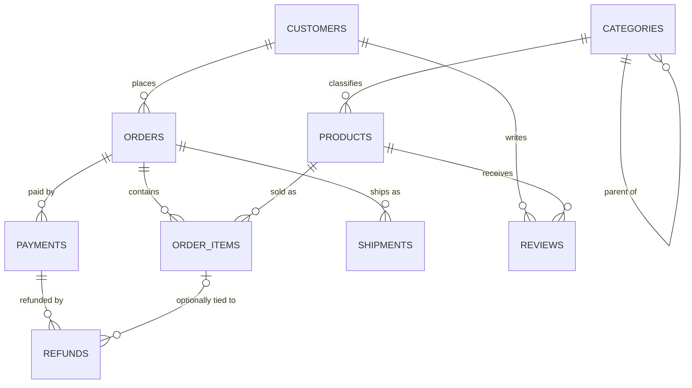
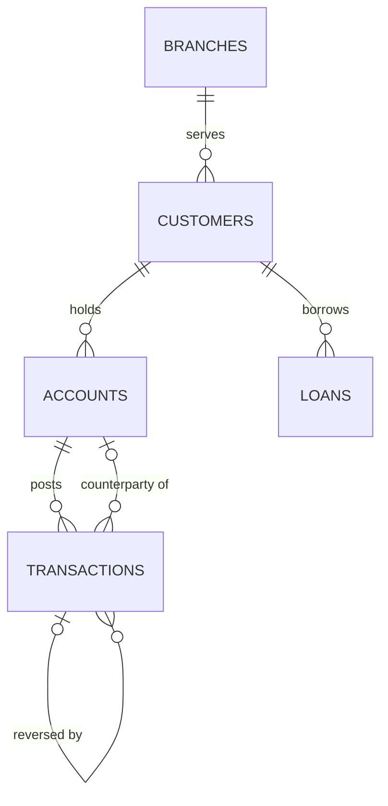
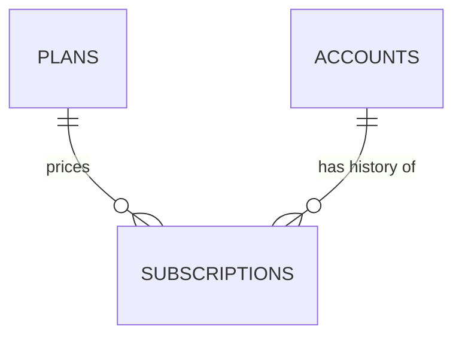

<div align="center">

# 🧪 SQL Exercise System

**19 hands-on MySQL exercises on 3 realistic datasets. Every exercise hides a trap, and every answer is executed by a validator.**


[Quick start](#-quick-start) ·
[How to practise](#-how-to-work-an-exercise) ·
[Datasets](#-datasets) ·
[Exercise index](#-exercise-index) ·
[Validation](#-validation) ·
[Contribute](#-adding-an-exercise) ·
[FAQ](#-faq)

</div>

---

## 📌 At a glance

| | |
|---|---|
| **What it is** | Practice problems paired with handbook modules 01–16, run against shared datasets instead of one-off toy tables |
| **Exercises** | 19: 2 BEGINNER · 6 EASY · 7 INTERMEDIATE · 4 ADVANCED |
| **Datasets** | `ecommerce` (9 tables) · `banking` (5) · `saas` (3), all InnoDB, hand-authored and deterministic |
| **Dialect** | MySQL 8.0 baseline; non-MySQL SQL is fenced ` ```sql postgresql ` and never presented as MySQL |
| **Verification** | A validator loads the data, runs every solution and every wrong answer, and diffs results against the documented output |
| **Needs** | A MySQL 8.x server and the `mysql` client. Python 3 (standard library only) for the validator |
| **Location** | [`exercises/`](.) · [`datasets/`](../datasets/) · [`scripts/validate_exercises.py`](../scripts/validate_exercises.py) |

## 🎯 Why this is different

Most SQL practice runs on clean toy tables, so the obvious query is also the right one. Here the **obvious query
is usually wrong**, because the data is realistic on purpose:

- An `INNER JOIN` silently drops the customers who have never ordered, which are exactly the rows the question asks for.
- Two independent one-to-many children fan out through their shared parent and inflate a revenue total.
- A `NULL` segment, a missing cost, or a reversed withdrawal changes what "correct" means.
- A customer who signed up twice only appears as a duplicate once the email is normalised.

Each exercise states its trap and shows the wrong query people actually write. The validator then **proves that
the wrong query returns a different result** from the solution, so the failure is demonstrated, not asserted.

## ⚡ Quick start

All commands run from the **repository root**.

```bash
# 1. Load a dataset (this creates the handbook_<dataset> database)
mysql -u root < datasets/ecommerce/schema.sql
mysql -u root < datasets/ecommerce/seed.sql

# 2. Open a session on it and try an exercise before reading the hints
mysql -u root handbook_ecommerce
#    e.g. exercises/03_joins/EX-03-003_products-never-ordered.md

# 3. Check your result against the exercise's Solution and Expected output
```

> [!WARNING]
> Each `schema.sql` begins with `DROP DATABASE IF EXISTS handbook_<dataset>`, so loading a dataset **deletes and
> recreates** that database. Use a local or throwaway server, never one holding data you care about.

Each exercise names its dataset in its front matter (`dataset:`), so you always know which one to load. To connect
over TCP, set `MYSQL_HOST`, `MYSQL_PORT`, `MYSQL_USER` and `MYSQL_PWD` (the validator reads the same variables).

New here? Start with [EX-01-001](01_fundamentals/EX-01-001_active-products-under-50.md), then follow the
[index](#-exercise-index) in module order.

## 🧭 How to work an exercise

1. **Read** the Scenario, Input assumptions and Task. Don't open the Solution.
2. **Write** your own query and compare it with the Expected output.
3. **Stuck?** Open the 3 hints one at a time. They are progressive, moving from conceptual direction toward the answer.
4. **Compare** with the Solution, then read the 9-point Explanation and **Common mistakes**. Run the wrong queries yourself and see how they differ.
5. **Stretch** with the Optional challenge.

## 📦 Datasets

Every dataset documents its **grain** (what one row means), its relationships and its **intentional data-quality
traps**. Don't "fix" the traps: exercises depend on them. In all three datasets the data ends on **2025-06-30**,
and exercises treat **2025-07-01** as "today".

| Dataset | Domain | Tables | Rows (largest tables) | Exercises |
|---|---|:-:|---|:-:|
| [`ecommerce`](../datasets/ecommerce/) | Customers, orders, payments, shipments, reviews | 9 | 24 customers · 49 orders · 91 order items | 13 |
| [`banking`](../datasets/banking/) | Customers, accounts, transactions, loans | 5 | 10 customers · 12 accounts · 27 transactions | 5 |
| [`saas`](../datasets/saas/) | Plans, accounts, subscription history | 3 | 10 accounts · 14 subscriptions | 1 |

### 🛒 `ecommerce`



**Grain.** `order_items` is the **revenue grain**, not `orders`. An order can have 0, 1 or several `payments`, and
more than one `shipments` row. A `refunds` row with `order_item_id IS NULL` is an order-level credit.

| Trap (intentional) | What goes wrong | Taught by |
|---|---|---|
| Email is case-sensitive and not unique | Customers 7 and 19 are one person. `COUNT(DISTINCT email)` gives 24, `COUNT(DISTINCT LOWER(email))` gives 23 | [EX-10-001](10_string_functions/EX-10-001_finding-duplicate-customers-by-normalized-email.md) |
| `customers.segment` is NULL for 4 customers | `GROUP BY segment` puts them in a NULL bucket you must handle | [EX-02-001](02_aggregations/EX-02-001_customers-by-segment-including-unclassified.md) |
| `products.cost_price` is NULL for 1 product | Margin is NULL for that row, not zero | [EX-11-002](11_null_handling/EX-11-002_products-with-no-recorded-cost.md) |
| Failed-then-retried and split payments | Summing every payment row overstates cash. Order 28 lines total 143.00 but its captured payment is 138.00 | [EX-11-001](11_null_handling/EX-11-001_amount-actually-collected-per-order.md) |
| One order has two shipments | Joining through `shipments` multiplies item rows and inflates revenue | [EX-03-002](03_joins/EX-03-002_revenue-without-shipment-fan-out.md) |
| 5 customers have never ordered | An `INNER JOIN` from `customers` to `orders` drops them | [EX-03-001](03_joins/EX-03-001_customers-with-zero-orders.md) |
| 1 product never sold, 1 product inactive | "Top products" and "active products" need an explicit rule | [EX-03-003](03_joins/EX-03-003_products-never-ordered.md), [EX-01-001](01_fundamentals/EX-01-001_active-products-under-50.md) |
| Order statuses: `placed`, `shipped`, `delivered`, `cancelled`, `returned` | A status-blind revenue sum includes cancelled orders | [EX-14-001](14_views/EX-14-001_a-view-that-encodes-eligible-revenue-once.md) |
| `order_items.unit_price` is the price at order time | Joining to `products.unit_price` rewrites history | no dedicated exercise yet |
| Order-level refunds, non-buyer and duplicate reviews, one NULL `shipping_city` | Attribution and "who bought" questions go wrong | no dedicated exercise yet |

### 🏦 `banking`



**Grain.** `transactions` is the ledger grain. A customer can hold 0, 1 or 2 accounts.

**Signed-amount convention.** `transactions.amount` is **always stored positive**. The type decides the sign:
`DEPOSIT`, `TRANSFER_IN`, `INTEREST` and `REVERSAL` add, while `WITHDRAWAL`, `TRANSFER_OUT` and `FEE` subtract. A
`REVERSAL` takes the opposite sign of what it reverses. In this dataset every reversal undoes a withdrawal, so it
adds funds back. A transfer is **two rows** (`TRANSFER_OUT` and `TRANSFER_IN`) linked only by
`counterparty_account_id`, with no shared transfer ID.

| Trap (intentional) | What goes wrong | Taught by |
|---|---|---|
| Reversed withdrawal on account 1 | Treating every `REVERSAL` as a debit gives a balance of 695.00 instead of 995.00 | [EX-05-001](05_case_when/EX-05-001_account-balance-from-signed-transaction-types.md) |
| Closed account (account 5) | Must stay in history but not in "currently open" reports (`closed_on IS NULL`) | [EX-04-001](04_subqueries/EX-04-001_dormant-accounts-excluding-closed.md) |
| Loans `DEFAULTED` and `PAID_OFF` | "Outstanding" must use `status = 'ACTIVE'`, because defaulted loans also have a `closed_on` | [EX-13-001](13_set_operators/EX-13-001_customers-with-savings-account-or-active-loan.md) |
| Overdrawn account 4 (balance -500.00) | Code that assumes balances are never negative misclassifies it | no dedicated exercise yet |
| Customer 10 has no account | An `INNER JOIN` to `accounts` drops them | no dedicated exercise yet |
| `risk_rating` NULL for 2 customers, `interest_rate` NULL on every checking account | The second is by design, the first is missing data | no dedicated exercise yet |

### 📈 `saas`



**Grain.** A `subscriptions` row is one **continuous period** an account spent on one plan. The current plan is the
row with `end_date IS NULL`. This release ships only `plans`, `accounts` and `subscriptions`; invoices, usage events
and payments are deliberately deferred rather than shipped half-verified.

The core teaching point is the three statuses. Counting every row with an `end_date` as "lost" overstates churn,
because it includes every plan change.

| Status | Meaning | Is it churn? |
|---|---|:-:|
| `ACTIVE` | In effect now, `end_date IS NULL` | no |
| `EXPIRED` | Ended because the account upgraded or downgraded; the next row continues | no |
| `CANCELED` | Ended because the customer left, with a `cancel_reason` | yes, unless a later row reactivates it |

| Trap (intentional) | What goes wrong | Taught by |
|---|---|---|
| Current MRR is 1192.00 across 8 active subscriptions | Summing all subscription rows counts plans nobody still pays for | [EX-12-001](12_advanced_aggregations/EX-12-001_current-mrr-by-plan-with-a-grand-total.md) |
| Account 7 changed plans twice | Its 2 `EXPIRED` rows are not churn | no dedicated exercise yet |
| Account 5 churned, then returned on a different plan with a gap | "Has any `CANCELED` row" wrongly flags a paying customer | no dedicated exercise yet |
| Only accounts 3 and 9 are truly churned at 2025-06-30 | Needs the latest row per account, not any row | no dedicated exercise yet |

## 📚 Exercise index

One or more exercises for every taught module, 01 through 16.

| ID | Title | Module | Difficulty | Category | Dataset |
|---|---|---|---|---|---|
| [EX-01-001](01_fundamentals/EX-01-001_active-products-under-50.md) | Active Products Under $50 | [01_Fundamentals](../01_Fundamentals/) | BEGINNER (L1) | FOUNDATIONS | ecommerce |
| [EX-02-001](02_aggregations/EX-02-001_customers-by-segment-including-unclassified.md) | Customers by Segment, Including Unclassified | [02_Aggregations](../02_Aggregations/) | EASY (L2) | AGGREGATION | ecommerce |
| [EX-03-001](03_joins/EX-03-001_customers-with-zero-orders.md) | Customers With Zero Orders | [03_Joins](../03_Joins/) | EASY (L2) | JOINS | ecommerce |
| [EX-03-002](03_joins/EX-03-002_revenue-without-shipment-fan-out.md) | Revenue Without the Shipment Fan-Out | [03_Joins](../03_Joins/) | ADVANCED (L4) | JOINS | ecommerce |
| [EX-03-003](03_joins/EX-03-003_products-never-ordered.md) | Products That Have Never Been Ordered | [03_Joins](../03_Joins/) | EASY (L2) | JOINS | ecommerce |
| [EX-04-001](04_subqueries/EX-04-001_dormant-accounts-excluding-closed.md) | Dormant Accounts, Excluding Closed Ones | [04_Subqueries](../04_Subqueries/) | INTERMEDIATE (L3) | SUBQUERIES | banking |
| [EX-05-001](05_case_when/EX-05-001_account-balance-from-signed-transaction-types.md) | Account Balance from Signed Transaction Types | [05_CASE_WHEN](../05_CASE_WHEN/) | INTERMEDIATE (L3) | FILTERING | banking |
| [EX-06-001](06_ctes/EX-06-001_customers-with-strong-net-deposits.md) | Customers With Strong Net Deposits | [06_CTEs](../06_CTEs/) | EASY (L2) | CTES | banking |
| [EX-07-001](07_window_functions/EX-07-001_top-2-products-by-monthly-revenue.md) | Top-2 Products by Monthly Revenue | [07_Window_Functions](../07_Window_Functions/) | INTERMEDIATE (L3) | WINDOW_FUNCTIONS | ecommerce |
| [EX-08-001](08_window_business_cases/EX-08-001_running-balance-for-a-single-account.md) | Running Balance for a Single Account | [08_WINDOW_BUSINESS_CASES](../08_WINDOW_BUSINESS_CASES/) | ADVANCED (L4) | WINDOW_FUNCTIONS | banking |
| [EX-09-001](09_date_functions/EX-09-001_customer-tenure-and-days-since-last-order.md) | Customer Tenure and Days Since Last Order | [09_Date_Functions](../09_Date_Functions/) | INTERMEDIATE (L3) | DATE_ANALYTICS | ecommerce |
| [EX-10-001](10_string_functions/EX-10-001_finding-duplicate-customers-by-normalized-email.md) | Finding Duplicate Customers by Normalized Email | [10_STRING_FUNCTIONS](../10_STRING_FUNCTIONS/) | EASY (L2) | STRING_ANALYTICS | ecommerce |
| [EX-11-001](11_null_handling/EX-11-001_amount-actually-collected-per-order.md) | Amount Actually Collected per Order | [11_NULL_HANDLING_AND_DATA_CLEANING](../11_NULL_HANDLING_AND_DATA_CLEANING/) | INTERMEDIATE (L3) | NULL_LOGIC | ecommerce |
| [EX-11-002](11_null_handling/EX-11-002_products-with-no-recorded-cost.md) | Products With No Recorded Cost | [11_NULL_HANDLING_AND_DATA_CLEANING](../11_NULL_HANDLING_AND_DATA_CLEANING/) | BEGINNER (L1) | NULL_LOGIC | ecommerce |
| [EX-12-001](12_advanced_aggregations/EX-12-001_current-mrr-by-plan-with-a-grand-total.md) | Current MRR by Plan, With a Grand Total | [12_ADVANCED_AGGREGATIONS](../12_ADVANCED_AGGREGATIONS/) | INTERMEDIATE (L3) | AGGREGATION | saas |
| [EX-13-001](13_set_operators/EX-13-001_customers-with-savings-account-or-active-loan.md) | Customers With a Savings Account or an Active Loan | [13_SET_OPERATORS](../13_SET_OPERATORS/) | EASY (L2) | SET_OPERATORS | banking |
| [EX-14-001](14_views/EX-14-001_a-view-that-encodes-eligible-revenue-once.md) | A View That Encodes "Eligible Revenue" Once | [14_VIEWS](../14_VIEWS/) | INTERMEDIATE (L3) | DATABASE_ENGINEERING | ecommerce |
| [EX-15-001](15_indexes/EX-15-001_a-composite-index-that-actually-gets-used.md) | A Composite Index That Actually Gets Used | [15_INDEXES](../15_INDEXES/) | ADVANCED (L4) | PERFORMANCE | ecommerce |
| [EX-16-001](16_query_optimization/EX-16-001_rewriting-correlated-subquery-as-a-join.md) | Rewriting a Per-Row Correlated Subquery as a Join | [16_QUERY_OPTIMIZATION](../16_QUERY_OPTIMIZATION/) | ADVANCED (L4) | PERFORMANCE | ecommerce |

### Difficulty

| Level | Difficulty | Means |
|---|---|---|
| L1 | BEGINNER | Single table, one concept, no NULLs or edge cases to reason about |
| L2 | EASY | Single table or simple two-table join; one filtering/aggregation twist |
| L3 | INTERMEDIATE | Multi-table join or subquery; grain and NULL handling matter |
| L4 | ADVANCED | Window functions, CTEs, or multi-step aggregation; a "the obvious query is wrong" trap |
| L5 | EXPERT | Combines several concepts; requires validating the result, not just producing one |

No exercise is EXPERT yet. The `estimated_time_min` values add up to 300 minutes (author estimates, not measurements).

### Categories

`FOUNDATIONS` `FILTERING` `AGGREGATION` `JOINS` `SUBQUERIES` `CTES` `WINDOW_FUNCTIONS` `DATE_ANALYTICS`
`STRING_ANALYTICS` `NULL_LOGIC` `DATA_CLEANING` `BUSINESS_ANALYTICS` `PERFORMANCE` `DATABASE_ENGINEERING`
`PRODUCTION_DEBUGGING` `SET_OPERATORS`

_`SET_OPERATORS` was added beyond the original 15-category list once Module 13 got its first exercise.
UNION/INTERSECT/EXCEPT work doesn't cleanly fit any of the other categories._

## 🔬 Anatomy of an exercise

Every file starts with front matter that the validator checks:

```yaml
---
id: EX-11-002
title: Products With No Recorded Cost
module: 11_NULL_HANDLING_AND_DATA_CLEANING
category: NULL_LOGIC
difficulty: BEGINNER
level: L1
estimated_time_min: 10
business_domain: E-commerce
dataset: ecommerce
tables: [products]
mysql_version: "8.0"
related_interview: null
---
```

Then, in this order, 15 sections:

| # | Section | What it gives you |
|:-:|---|---|
| 1 | Learning objectives | What you will be able to do afterwards |
| 2 | Business context | Why anyone would ask this question |
| 3 | Scenario | The concrete request |
| 4 | Input assumptions | What the data does and does not guarantee |
| 5 | Task | Exactly what to produce |
| 6 | Constraints | Rules the query must respect |
| 7 | Expected output | The real result table, checked by the validator against a live run |
| 8 | Hints | Exactly 3, progressive, collapsed in `<details>` |
| 9 | Solution | Exactly one plain `sql` block (optional `sql setup` blocks first) |
| 10 | Explanation | 9 labelled points: Grain, Rows that survive, Filtering, Join cardinality, Aggregation, NULL behavior, Why it is correct, What could make it slow, How to validate |
| 11 | Common mistakes | Each with a ` ```sql wrong ` block the validator proves returns a *different* result |
| 12 | Edge cases | Inputs that could break the solution |
| 13 | Performance notes | What changes with scale |
| 14 | Optional challenge | A stretch variation |
| 15 | Related | Module and sibling-exercise links |

`related_interview` is `null` in all 19 exercises. Linking them to
[Module 18](../18_SQL_INTERVIEW_QUESTIONS/) questions is planned but not done.

## ✅ Validation

[`scripts/validate_exercises.py`](../scripts/validate_exercises.py) checks every exercise in two layers.

**Static** (no database needed):

- Front matter is complete and consistent with the file name, folder, difficulty/level and category list.
- The module folder exists, and the referenced dataset and tables exist in the dataset's `schema.sql`.
- IDs, titles and solution SQL are unique.
- All 15 sections are present, with exactly 3 hints and all 9 Explanation labels.
- There is exactly one plain solution block, and no PostgreSQL-only syntax in MySQL-labelled SQL.
- Relative links in each exercise file resolve.

**Live** (needs a reachable MySQL 8.x server):

- The dataset loads, and every `setup` block and the solution run without error.
- The solution's real result matches the **Expected output** table cell for cell.
- Every `wrong` block runs *and* returns a different result from the solution.

```bash
python3 scripts/validate_exercises.py --no-db      # static checks only
python3 scripts/validate_exercises.py              # static + live MySQL checks
python3 scripts/validate_exercises.py EX-03-002    # a single exercise
python3 scripts/validate_exercises.py --update     # rewrite Expected-output tables from real results
```

> [!WARNING]
> Review the diff before committing anything produced by `--update`. It rewrites Expected-output tables from
> whatever the query currently returns, so a wrong solution would silently become the "expected" answer.

The validator works in a full repository checkout. In a standalone copy of `datasets/` + `exercises/` + `scripts/`,
the module-folder and module-link checks are skipped with a printed notice. A GitHub Actions workflow,
[`validate-exercises.yml`](../.github/workflows/validate-exercises.yml), runs it against a MySQL 8.0 service
container on pushes and pull requests that touch `exercises/`, `datasets/`, the validator or the workflow itself.

Latest recorded results are in [`PROJECT_STATUS.md`](../PROJECT_STATUS.md): all 19 exercises pass both the static
and the live validator on MySQL 8.0.46.

## ➕ Adding an exercise

1. Pick a module and dataset, then find a real trap in the dataset section above. Don't invent a clean-data demo.
2. Copy an existing exercise and give it the next ID for its module (`EX-NN-00X`), with a file name starting with that ID.
3. Fill all 15 sections: 3 hints, 9 labelled Explanation points, one plain `sql` solution, and `sql wrong` blocks
   that return a different result from it.
4. If the solution creates indexes or views, add `mutates: "true"` to the front matter so the dataset is reloaded
   cleanly before and after.
5. Run the static validator, then the full one. Use `--update` only after reviewing the diff.
6. Add the row to the [index](#-exercise-index) and update [`PROJECT_STATUS.md`](../PROJECT_STATUS.md).

General rules: [`CONTRIBUTING.md`](../CONTRIBUTING.md) · [`STYLE_GUIDE.md`](../STYLE_GUIDE.md).

## 🚧 Known limitations

- **MySQL 8.0 is the baseline.** Live validation has so far been run on MySQL 8.0.46 only. Other 8.x releases,
  MySQL 9.x and MariaDB are untested.
- **Small data.** The datasets favour hand-verifiability over scale. `EXPLAIN` and timing notes (for example in
  EX-15-001 and EX-16-001) describe these small datasets, not every environment.
- **Early coverage.** Most modules have one exercise so far (module 03 has 3, module 11 has 2).
- **Several documented traps have no exercise yet**, as marked in the dataset tables above.
- **No interview cross-links yet.**

## ❓ FAQ

**Do I need to finish the handbook modules first?** No, but each exercise lists its module, and the exercises
assume you know that module's concept.

**Why are the datasets so small?** So you can verify every answer by hand. Realistic volume would be needed to
teach scale-dependent performance behaviour, and that isn't claimed here.

**Can I run these on PostgreSQL?** The exercises are written and validated for MySQL 8.0. Any PostgreSQL variant
appears only in blocks explicitly fenced ` ```sql postgresql `.

**Can I change the data?** Yes, locally. Reloading a dataset restores the original, and exercises that create
indexes or views are reset automatically by the validator.

## 🔗 Related

[Handbook home](../README.md) · [Roadmap](../ROADMAP.md) ·
[Module 18: SQL Interview Questions](../18_SQL_INTERVIEW_QUESTIONS/) · [Project status](../PROJECT_STATUS.md) ·
[Contributing](../CONTRIBUTING.md)

<sub>Every solution, wrong-answer block and Expected-output table in the 19 exercises has been executed against a live MySQL 8.0 server.</sub>